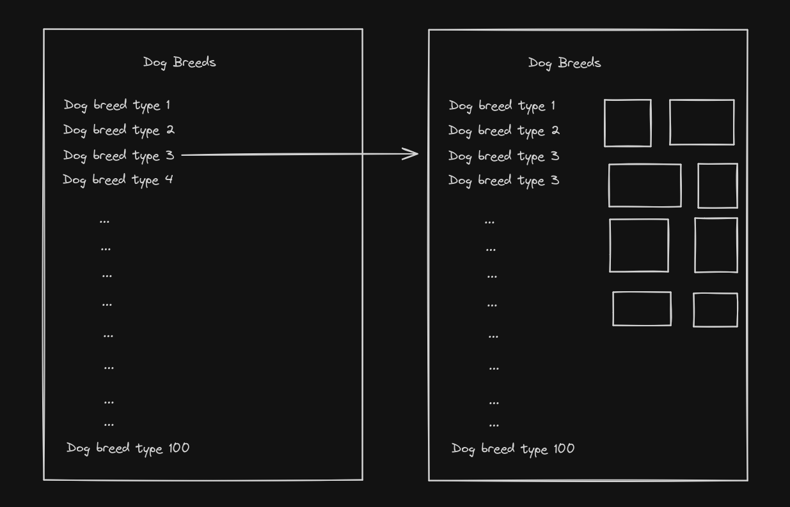

# Assignment: Dog API

## Introduction

So far, we've learned about advanced JavaScript fundamentals, introduced object-oriented and functional programming, and learned about asynchronicity. In this exercise, we will use what we've learned in the course to create a simple application to retrieve dog breeds and their images.

### Starter Files

-   `index.html`
-   `style.css`
-   `script.js`
-   `DogBreeds.js`
-   `DogBreed.js`

## Requirements

Use the `Axios` library to create a website that retrieves information on dog breeds and their corresponding images from an API.

Much like the Bookshelf exercise, this exercise has two parts:

1. The classes that model the behavior of dog breeds.
2. The user interface that displays the data in the browser.

### Classes

Create a `DogBreeds` and `DogBreed` classes. The `DogBreeds` class stores an array of `DogBreed` objects. Each class should be created within its own module and exported using ESM syntax. They should then be imported into the `script.js` file.

Implement the following on `DogBreeds`:

-   a `list` private instance variable to store an array of `DogBreed` objects.
-   a getter for `list`.
-   `addImagesToDogBreed(name, images)`: adds images to the `DogBreed` element within `list` that matches `name`.
-   `getImagesByDogBreedName(name)`:
    -   returns a set of images by dog breed name.
    -   if images already exist for that breed, return the existing array of images.
-   the class should be defined within a module named `DogBreeds.js`.

Implement the following on `DogBreed`:

-   `name` and `images` private instance variables used to store the breed name and array of images respectively.
-   getters for `name` and `images`.
-   a setter for `images`.
-   the class should be defined within a module named `DogBreed.js`.

Constraints:

-   Do not use loops (e.g., for, while) in your implementation (except for removing elements from the DOM).
-   All promises should be handled using async / await.
-   You must use array higher-order functions (e.g., `forEach`, `filter()`, `map()`) to implement the methods.
-   Images should be an empty array by default.

### User Interface

Review the [Dog API](https://dog.ceo/dog-api/documentation/breed). Create a one-page website that loads all dog breeds from the API on load and generates a list of anchors. When clicking on anchor, it should load the list of images of that particular breed from the API, populate those images within the `DogBreeds` instance, and display it on the right side of the page beside the anchors. Clicking on another anchor should replace the existing images with the new list. Feel free to use the provided stylesheet or create your own.

## Wireframe

